<picture>
  <source media="(prefers-color-scheme: dark)" srcset="assets/banner-dark.svg">
  <source media="(prefers-color-scheme: light)" srcset="assets/banner-light.svg">
  
</picture>

## Profile

I work on **ambiguous problems at the intersection of business, product, and execution**.

My background spans **SaaS, product management, creative systems, and early-stage ventures**, where I’ve translated unclear problem statements into structured actions and shipped outcomes under constraints.

I’m particularly interested in **strategy, market analysis, operating models, and execution planning**.

<picture>
  <source media="(prefers-color-scheme: dark)" srcset="assets/divider-dark.svg">
  
</picture>

## Consulting Lens

```txt
• Problem structuring & hypothesis-driven thinking
• Market & user analysis
• Product and GTM alignment
• Operating under constraints
• Decision-making with incomplete information
```

## Experience Themes

<details>
<summary><b>Product & Business Ownership</b></summary>

- End-to-end ownership across multiple product initiatives  
- Framing ambiguous business problems into executable roadmaps  
- Supporting go-to-market planning and UX decisions  
- Balancing speed, quality, and business impact  

</details>

<details>
<summary><b>Entrepreneurial & Zero-to-One Work</b></summary>

- Built and launched SaaS products with real users  
- Worked across ideation, validation, execution, and iteration  
- Learned prioritization through real constraints  

</details>

<details>
<summary><b>Creative Systems as Leverage</b></summary>

- Led scalable creative workflows and communities  
- Used storytelling and design to improve clarity and adoption  
- Applied systems thinking beyond traditional tech domains  

</details>

<picture>
  <source media="(prefers-color-scheme: dark)" srcset="assets/divider-dark.svg">
  
</picture>

## Things I've made

<table>
  <tr>
    <td width="50%" valign="top">
      <a href="https://relay.rishishah.in"></a>
      <br />
      <b><a href="https://relay.rishishah.in">Relay</a></b> · Free, peer-to-peer file transfer in the browser. End-to-end encrypted, nothing uploaded, no account, no size limit.
      <br />
      <sub><a href="https://relay.rishishah.in">relay.rishishah.in</a> · <a href="https://github.com/byrishi/Relay">Source</a> · Apache-2.0</sub>
      <br />
      <a href="https://github.com/byrishi/Relay/stargazers"></a>&nbsp;&nbsp;<a href="https://github.com/byrishi/Relay/commits"></a>
    </td>
    <td width="50%" valign="top">
      <a href="https://helio.rishishah.in"></a>
      <br />
      <b><a href="https://helio.rishishah.in">Helio</a></b> · A free, open-source dashboard that shows exactly what your rooftop solar made today.
      <br />
      <sub><a href="https://helio.rishishah.in">helio.rishishah.in</a> · <a href="https://helio.rishishah.in/demo">Live demo</a> · <a href="https://github.com/byrishi/helio">Source</a> · MIT</sub>
      <br />
      <a href="https://github.com/byrishi/helio/stargazers"></a>&nbsp;&nbsp;<a href="https://github.com/byrishi/helio/commits"></a>
    </td>
  </tr>
</table>

| | |
|---|---|
| **[Zenodo Certificate Maker](https://github.com/byrishi/ZENODO_CERT_MAKER)** | Turns a Zenodo record into a print-ready A4 certificate, because academia wants paper. |
| **[VaultNote](https://github.com/byrishi/Vault-Note)** | Local-first encrypted notes. Everything is sealed in your browser with AES-GCM. |

### Activity

<a href="https://github.com/byrishi">
<picture>
  <source media="(prefers-color-scheme: dark)" srcset="https://raw.githubusercontent.com/byrishi/byrishi/output/gta-hud-dark.svg">
  <source media="(prefers-color-scheme: light)" srcset="https://raw.githubusercontent.com/byrishi/byrishi/output/gta-hud-light.svg">
  
</picture>
</a>

<sub>Cash = contributions this year × $100 · wanted stars = the last 7 days · skyline = one tower per week · minimap = the last 22 weeks. Redrawn every hour.</sub>

### Sound

[Thepla Theorist](https://direct.me/theplatheorist) · [Rishi Shah Beatz](https://www.hopp.bio/rishishahbeatz) · [Discography](https://links.rishishah.in/discography)

### Stack

**Frontend** &nbsp; Next.js · React · TypeScript · Vite · Tailwind · shadcn/ui · GSAP · Lenis · WebGL / GLSL<br>
**Backend & bots** &nbsp; Python · FastAPI · Node.js · Express · python-telegram-bot · Telegram Mini Apps<br>
**Real-time & media** &nbsp; WebRTC · Web Audio · Web Crypto · ffmpeg · yt-dlp<br>
**Ship** &nbsp; Vercel · Render · Oracle Cloud · Cloudflare · Docker · GitHub Actions

<picture>
  <source media="(prefers-color-scheme: dark)" srcset="assets/divider-dark.svg">
  
</picture>

## How I Think

> Strategy is choosing what not to build.  
> Execution is making the right things inevitable.

<table><tr>
<td width="140">
<picture>
  <source media="(prefers-color-scheme: dark)" srcset="assets/face-blink-dark.svg">
  
</picture>
</td>
<td>

**Say hi.** rishi [at] rishishah [dot] in

[rishishah.in](https://rishishah.in) · [X](https://x.com/rishhishah) · [LinkedIn](https://www.linkedin.com/in/rishhishah) · [Peerlist](https://peerlist.io/rishhishah) · [Product Hunt](https://www.producthunt.com/@byrishi) · [Medium](https://rishhishah.medium.com)

<sub>Ankleshwar, India · open to consulting & strategy roles</sub>

</td>
</tr></table>
