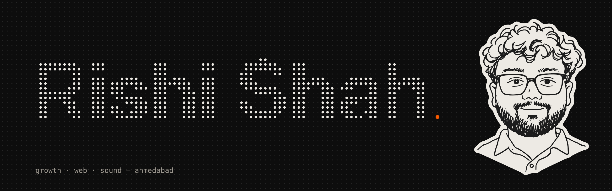

<picture>
  <source media="(prefers-color-scheme: dark)" srcset="assets/banner-dark.png">
  <source media="(prefers-color-scheme: light)" srcset="assets/banner-light.png">
  
</picture>

## Profile

I work on **ambiguous problems at the intersection of business, product, and execution**.

My background spans **SaaS, product management, creative systems, and early-stage ventures**, where I’ve translated unclear problem statements into structured actions and shipped outcomes under constraints.

I’m particularly interested in **strategy, market analysis, operating models, and execution planning**.

<picture>
  <source media="(prefers-color-scheme: dark)" srcset="assets/divider-dark.svg">
  
</picture>

## Consulting Lens

```txt
• Problem structuring & hypothesis-driven thinking
• Market & user analysis
• Product and GTM alignment
• Operating under constraints
• Decision-making with incomplete information
```

## Experience Themes

<details>
<summary><b>Product & Business Ownership</b></summary>

- End-to-end ownership across multiple product initiatives  
- Framing ambiguous business problems into executable roadmaps  
- Supporting go-to-market planning and UX decisions  
- Balancing speed, quality, and business impact  

</details>

<details>
<summary><b>Entrepreneurial & Zero-to-One Work</b></summary>

- Built and launched SaaS products with real users  
- Worked across ideation, validation, execution, and iteration  
- Learned prioritization through real constraints  

</details>

<details>
<summary><b>Creative Systems as Leverage</b></summary>

- Led scalable creative workflows and communities  
- Used storytelling and design to improve clarity and adoption  
- Applied systems thinking beyond traditional tech domains  

</details>

<picture>
  <source media="(prefers-color-scheme: dark)" srcset="assets/divider-dark.svg">
  
</picture>

## Things I've made

| | |
|---|---|
| **[Relay](https://github.com/byrishi/Relay)** | Send files straight from one browser to another. End-to-end encrypted, nothing stored in between. [Live ↗](https://relay.rishishah.in) |
| **[Helio](https://github.com/byrishi/helio)** | Open-source dashboard for what your rooftop solar actually generates. [Live ↗](https://helio.rishishah.in) |
| **[VaultNote](https://github.com/byrishi/Vault-Note)** | Local-first encrypted notes. Everything is sealed in your browser with AES-GCM. |
| **[Zenodo Certificate Maker](https://github.com/byrishi/ZENODO_CERT_MAKER)** | Turns a Zenodo record into a print-ready A4 certificate, because academia wants paper. |
| **[Zomòda](https://github.com/byrishi/zomodo)** | Marketing site for a fair-price retail concept. Next.js, GSAP scroll assembly, Lenis. |

### Sound

[Thepla Theorist](https://direct.me/theplatheorist) · [Rishi Shah Beatz](https://www.hopp.bio/rishishahbeatz) · [Discography](https://links.rishishah.in/discography)

### Stack

Next.js · React · TypeScript · Tailwind · GSAP · WebGL / GLSL · Web Audio

<picture>
  <source media="(prefers-color-scheme: dark)" srcset="assets/divider-dark.svg">
  
</picture>

## How I Think

> Strategy is choosing what not to build.  
> Execution is making the right things inevitable.

<table><tr>
<td width="140">
<picture>
  <source media="(prefers-color-scheme: dark)" srcset="assets/face-blink-dark.svg">
  
</picture>
</td>
<td>

**Say hi.** rishi [at] rishishah [dot] in

[rishishah.in](https://rishishah.in) · [X](https://x.com/rishhishah) · [LinkedIn](https://www.linkedin.com/in/rishhishah) · [Peerlist](https://peerlist.io/rishhishah) · [Product Hunt](https://www.producthunt.com/@byrishi) · [Medium](https://rishhishah.medium.com)

<sub>Ahmedabad, India · open to consulting & strategy roles</sub>

</td>
</tr></table>
