<p align="center">
  
</p>

<p align="center">
  <a href="https://rishishah.in"></a>
  <a href="https://x.com/rishhishah"></a>
  <a href="https://relay.rishishah.in"></a>
  <a href="https://helio.rishishah.in"></a>
</p>

<br />



<br />

### ◐ &nbsp;Open work

<sub>Things you can fork, run and read. Click a card to open the repo.</sub>

<table>
  <tr>
    <td width="50%"><a href="https://github.com/byrishi/Relay"></a></td>
    <td width="50%"><a href="https://github.com/byrishi/helio"></a></td>
  </tr>
  <tr>
    <td width="50%"><a href="https://github.com/byrishi/Vault-Note"></a></td>
    <td width="50%"><a href="https://github.com/byrishi/ZENODO_CERT_MAKER"></a></td>
  </tr>
  <tr>
    <td width="50%"><a href="https://github.com/byrishi/zomodo"></a></td>
    <td width="50%"><a href="https://rishishah.in"></a></td>
  </tr>
</table>

<br />

### ◑ &nbsp;How I build

```txt
01  Your data stays on your device unless it has a reason not to.
02  No accounts, no uploads, no tracking cookies, if I can avoid them.
03  Every pixel should mean something. Remove the rest.
04  Free to host, open to read, credited when reused.
```

<br />

### ◒ &nbsp;Toolbox

<p>
  
  
  
  
  
  
  
  
  
</p>

<br />

<p align="center">
  <sub>Ahmedabad, India &nbsp;·&nbsp; open to collaborations, odd ideas and good music</sub>
</p>
